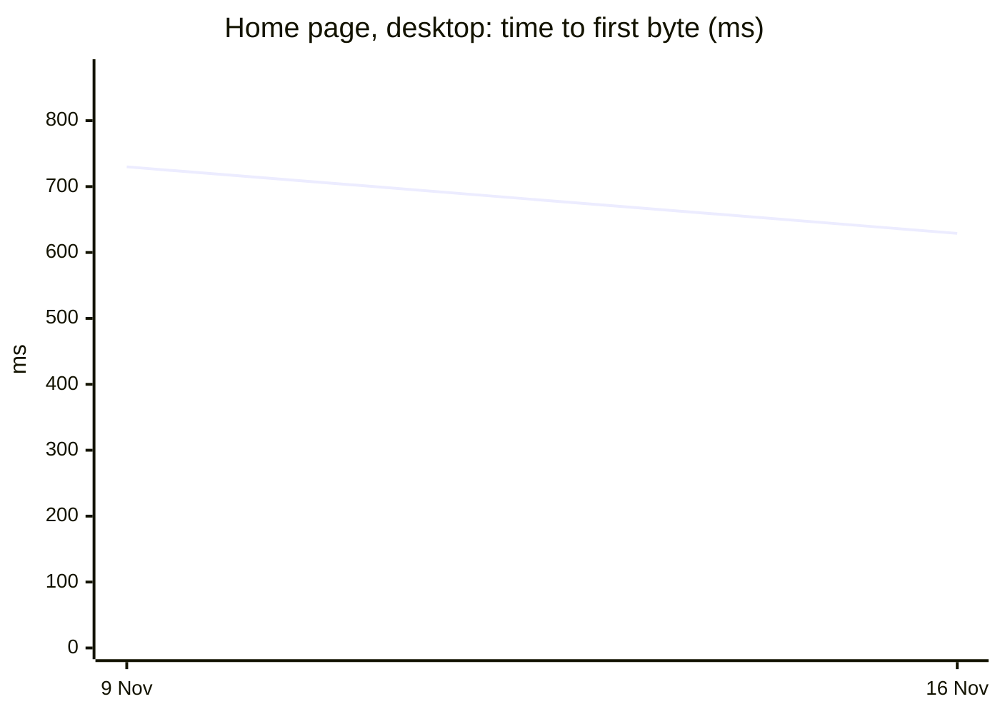
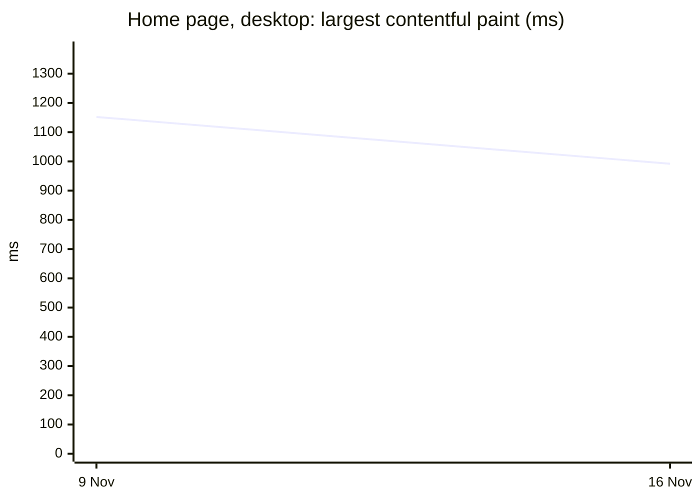
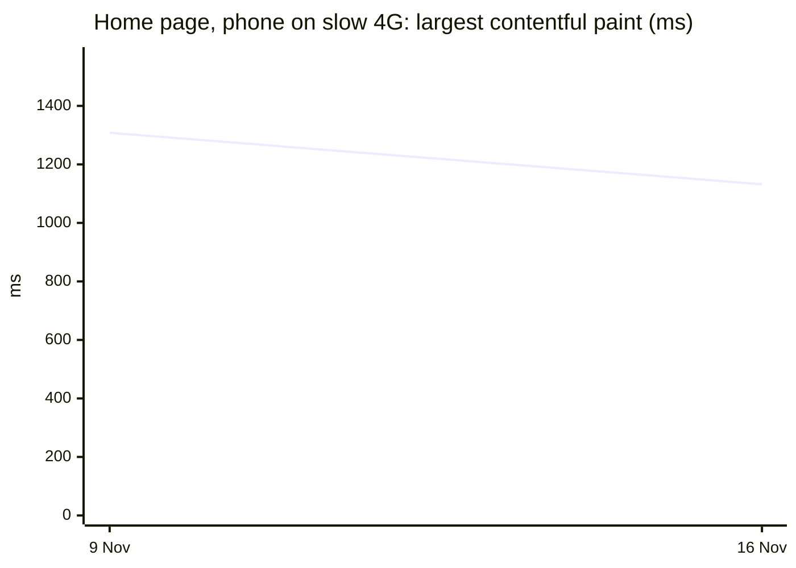
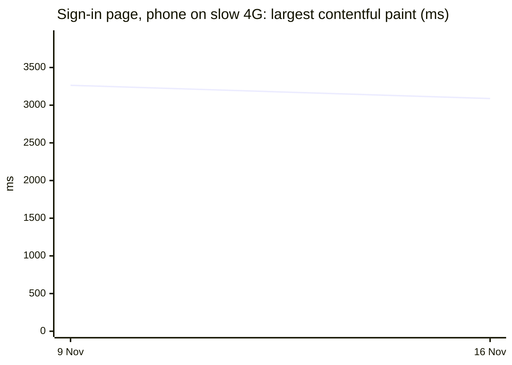
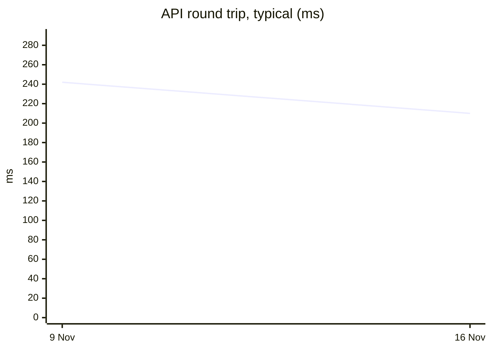

# CKAuth real-world performance

Measured every week from **GitHub Actions runner (US)** against https://ckauth.chiragdev.com, by `scripts/perf/measure.js` on `main`.
Each number is the median of 7 cold page loads in Chromium (no cache, new connections). Lower is better.

**Latest run:** 16 Nov 2026 · compared with 9 Nov 2026

## Latest run against the previous one

| Where | Metric | Previous run | Latest run | Change |
|---|---|--:|--:|---|
| Desktop · home page | Time to first byte | 730 ms | 629 ms | ⚪ −14% |
| Desktop · home page | Largest contentful paint | 1,152 ms | 992 ms | ⚪ −14% |
| Desktop · home page | Page fully loaded | 1,953 ms | 1,712 ms | ⚪ −12% |
| Desktop · home page | Layout shift | 0.090 | 0.069 | ⚪ −23% |
| Desktop · home page | Downloaded | 408 KB | 294 KB | 🟢 **−28%** smaller |
| Desktop · sign-in page | Time to first byte | 731 ms | 692 ms | ⚪ −5% |
| Desktop · sign-in page | Largest contentful paint | 2,092 ms | 1,984 ms | ⚪ −5% |
| Desktop · sign-in page | Page fully loaded | 1,742 ms | 1,648 ms | ⚪ −5% |
| Desktop · sign-in page | Layout shift | 0.000 | 0.000 | ⚪ ±0% |
| Desktop · sign-in page | Downloaded | 207 KB | 203 KB | ⚪ −2% |
| Phone on slow 4G · home page | Time to first byte | 728 ms | 630 ms | ⚪ −13% |
| Phone on slow 4G · home page | Largest contentful paint | 1,308 ms | 1,132 ms | ⚪ −13% |
| Phone on slow 4G · home page | Page fully loaded | 2,679 ms | 2,498 ms | ⚪ −7% |
| Phone on slow 4G · home page | Layout shift | 0.001 | 0.001 | ⚪ ±0% |
| Phone on slow 4G · home page | Downloaded | 289 KB | 294 KB | ⚪ +2% |
| Phone on slow 4G · sign-in page | Time to first byte | 729 ms | 692 ms | ⚪ −5% |
| Phone on slow 4G · sign-in page | Largest contentful paint | 3,264 ms | 3,088 ms | ⚪ −5% |
| Phone on slow 4G · sign-in page | Page fully loaded | 2,302 ms | 2,188 ms | ⚪ −5% |
| Phone on slow 4G · sign-in page | Layout shift | 0.000 | 0.000 | ⚪ ±0% |
| Phone on slow 4G · sign-in page | Downloaded | 207 KB | 203 KB | ⚪ −2% |
| API (`GET /api/`) | Round trip, typical | 242 ms | 210 ms | ⚪ −13% |
| API (`GET /api/`) | Round trip, slowest 5% | 243 ms | 210 ms | ⚪ −13% |

🟢 faster · 🔴 slower · ⚪ within normal noise (under 25%, or only a few ms)

## Trend

## What the metrics mean

- **Time to first byte (TTFB):** from clicking to the first byte of the page arriving: DNS lookup, connection and TLS handshake, the edge proxy and the server. Mostly distance; a jump here is the server or the network.
- **Largest contentful paint (LCP):** when the biggest thing on screen (usually the headline) appears. Google counts under 2,500 ms as good.
- **Page fully loaded:** when the browser's load event finishes (every script, style and font).
- **Layout shift (CLS):** how much the page jumps while loading. Under 0.1 is good; 0 means nothing moves.
- **Downloaded:** everything the page fetched, compressed. A jump here is usually a bigger JavaScript bundle.
- **API round trip:** `GET /api/` from inside a loaded page on a warm connection: network there and back, plus the edge proxy and Express.
- **Phone on slow 4G:** a 1.6 Mbit/s connection and a CPU 4× slower than the runner's (Lighthouse's mobile preset). Chrome adds latency once per request, so it is gentler on TTFB than a real slow network.

Every run

| Date | Desktop TTFB | Desktop LCP | Phone LCP | Phone sign-in LCP | Home KB | API typical |
|---|--:|--:|--:|--:|--:|--:|
| 16 Nov 2026 | 629 ms | 992 ms | 1,132 ms | 3,088 ms | 294 KB | 210 ms |
| 9 Nov 2026 | 730 ms | 1,152 ms | 1,308 ms | 3,264 ms | 408 KB | 242 ms |

